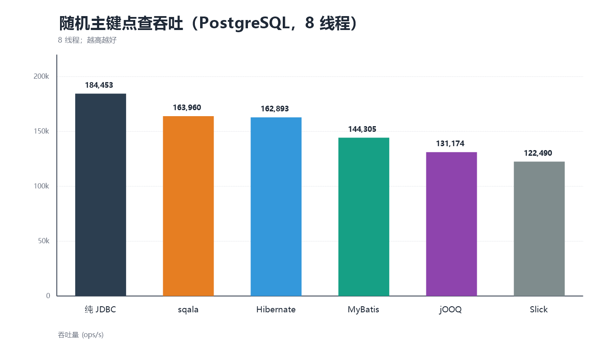
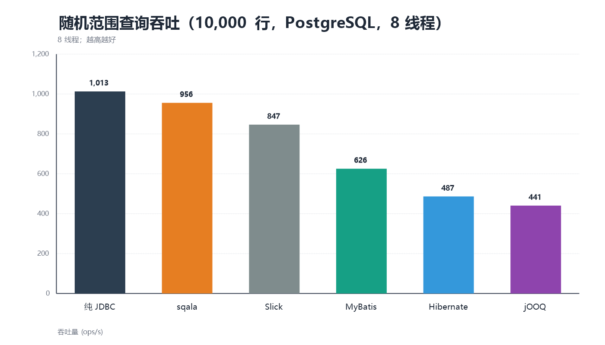
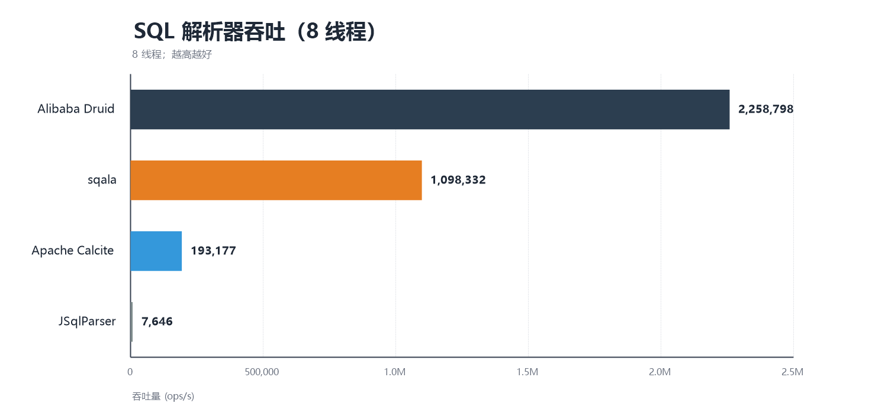
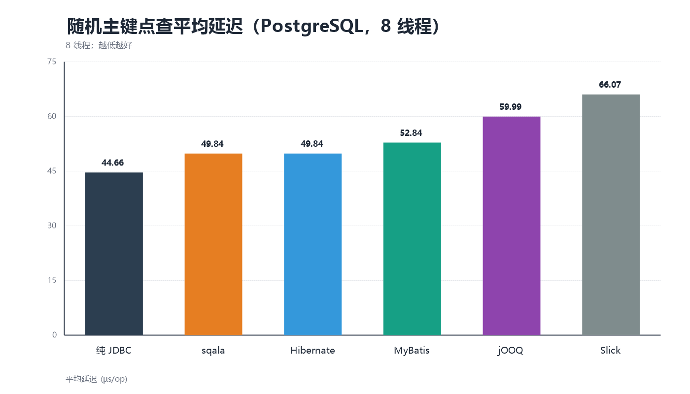
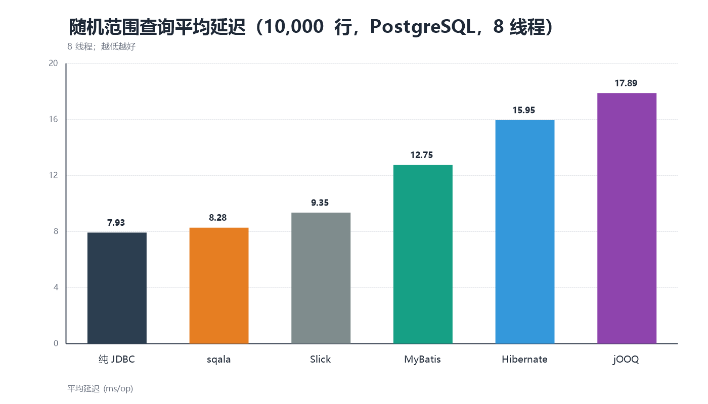
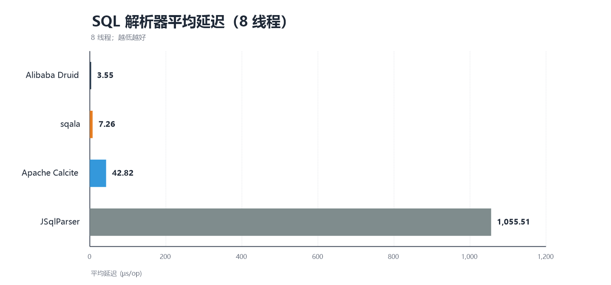

# sqala JMH Benchmark

对比 sqala 与常见 JVM 数据库访问框架的查询 / 反序列化性能，以及 SQL 解析器的解析性能。

当前配置：**只使用本地 PostgreSQL，8 线程并发**。

## 环境

- JDK 17.0.8
- Scala 3.9.0
- PostgreSQL 16.3，`localhost:5432/postgres`，用户 `postgres`，密码 `123456`
- 所有框架共用同一个 HikariCP 连接池（maximumPoolSize = 32，minimumIdle = 8）
- sqala 使用 `PostgresqlJdbcDialect`；Hibernate 使用 PostgreSQL dialect，jOOQ 使用 `SQLDialect.POSTGRES`，Slick 使用 `PostgresProfile`
- CPU：13th Gen Intel Core i7-13790F（16C/24T），内存 64 GB
- JMH：1 fork、**8 threads**、3 × 1s warmup、5 × 1s measurement、`-Xms2g -Xmx4g`

## 数据

启动时自动建表，并写入 100,000 行数据（行数不为 100,000 时会重建）：

```sql
CREATE TABLE IF NOT EXISTS bench_user (
    id          BIGINT PRIMARY KEY,
    name        VARCHAR(64)  NOT NULL,
    email       VARCHAR(128) NOT NULL,
    age         INT          NOT NULL,
    active      BOOLEAN      NOT NULL,
    score       NUMERIC(18,2) NOT NULL,
    created_at  TIMESTAMP    NOT NULL,
    bio         TEXT,
    city        VARCHAR(64),
    balance     DOUBLE PRECISION NOT NULL
);
```

`bio` 每 10 行、`city` 每 20 行为 `NULL`，用于覆盖 `Option` / 可空字段解码。

## 测试项

1. `PointQueryBenchmark`：随机主键点查，读取全部 10 列并反序列化为对象。
2. `RangeQueryBenchmark`：随机起点，返回连续 10,000 行，读取全部 10 列并反序列化。
3. `ParserBenchmark`：解析同一条包含 JOIN、BETWEEN、聚合、HAVING、ORDER BY、LIMIT/OFFSET 的分析型 SQL。

对比实现：

- sqala
- 纯 JDBC
- MyBatis 3.5.19
- Hibernate ORM 6.6.4
- jOOQ 3.19.15
- Slick 3.6.1

解析器：

- sqala 内置解析器
- Alibaba Druid 1.2.23
- Apache Calcite 1.38.0
- JSqlParser 5.0

## 运行

```bash
# 冒烟测试
sbt "benchmark/runMain bench.SanityCheck"

# 8 线程平均延迟
sbt "benchmark/Jmh/run -rf json -rff benchmark/target/jmh-result-pg-mt-latency.json"

# 8 线程吞吐（ops/s）
sbt "benchmark/Jmh/run -bm thrpt -tu s -rf json -rff benchmark/target/jmh-result-pg-mt-thrpt.json"

# 只跑某一项
sbt "benchmark/Jmh/run -bm thrpt -tu s .*PointQueryBenchmark.*"
sbt "benchmark/Jmh/run -bm thrpt -tu s .*RangeQueryBenchmark.*"
sbt "benchmark/Jmh/run -bm thrpt -tu s .*ParserBenchmark.*"

# 只重跑解析器，并单独保存结果（图表脚本会优先读取这两个文件）
sbt "benchmark/Jmh/run -bm thrpt -tu s -rf json -rff benchmark/target/jmh-result-pg-mt-parser-thrpt.json .*ParserBenchmark.*"
sbt "benchmark/Jmh/run -bm avgt -rf json -rff benchmark/target/jmh-result-pg-mt-parser-latency.json .*ParserBenchmark.*"
```

所有 benchmark 类都通过 `@Threads(8)` 固定为 8 线程。

## 8 线程吞吐（主指标）

### 1. 随机主键点查 + 反序列化

| 实现 | 吞吐 (ops/s) | 相对 sqala | 8 线程延迟 (µs/op) |
| --- | ---: | ---: | ---: |
| 纯 JDBC | 184,453 | 1.13x | 44.661 |
| **sqala** | **163,960** | **1.00x** | **49.842** |
| Hibernate | 162,893 | 0.99x | 49.843 |
| MyBatis | 144,305 | 0.88x | 52.845 |
| jOOQ | 131,174 | 0.80x | 59.990 |
| Slick | 122,490 | 0.75x | 66.066 |

### 2. 随机范围查询 10,000 行 + 反序列化

| 实现 | 吞吐 (ops/s) | 相对 sqala | 行吞吐 (行/s) | 8 线程延迟 (ms/op) |
| --- | ---: | ---: | ---: | ---: |
| 纯 JDBC | 1,013.4 | 1.06x | 10,134,000 | 7.930 |
| **sqala** | **956.1** | **1.00x** | **9,561,000** | **8.285** |
| Slick | 846.5 | 0.89x | 8,465,000 | 9.352 |
| MyBatis | 625.8 | 0.65x | 6,258,000 | 12.754 |
| Hibernate | 486.6 | 0.51x | 4,866,000 | 15.953 |
| jOOQ | 440.6 | 0.46x | 4,406,000 | 17.886 |

### 3. SQL 解析器

| 解析器 | 吞吐 (ops/s) | 相对 sqala | 8 线程延迟 (µs/op) |
| --- | ---: | ---: | ---: |
| Alibaba Druid | 2,258,798 | 2.06x | 3.554 |
| **sqala 内置解析器** | **1,098,332** | **1.00x** | **7.258** |
| Apache Calcite | 193,177 | 0.18x | 42.819 |
| JSqlParser | 7,646 | 0.007x | 1,055.507 |

## 图表

`benchmark/scripts/plot-jmh.ps1` 根据最新结果生成以下柱状图（中文版输出到 `benchmark/charts`，英文版输出到 `benchmark/charts/en`）：

### 吞吐量（越高越好）







### 平均延迟（越低越好）







重新生成：

```powershell
# 中文图表
powershell -ExecutionPolicy Bypass -File benchmark/scripts/plot-jmh.ps1 -Language zh

# 英文图表
powershell -ExecutionPolicy Bypass -File benchmark/scripts/plot-jmh.ps1 -Language en
```

## 单线程到 8 线程扩展

单线程数据取同一 PostgreSQL 配置下的上一轮测试；8 线程数据取本轮吞吐测试。

| Benchmark | 单线程吞吐 | 8 线程吞吐 | 扩展比 |
| --- | ---: | ---: | ---: |
| PointQuery.plainJdbc | 32,728 ops/s | 184,453 ops/s | 5.64x |
| PointQuery.sqala | 29,136 ops/s | 163,960 ops/s | 5.63x |
| PointQuery.hibernate | 29,188 ops/s | 162,893 ops/s | 5.58x |
| PointQuery.myBatis | 27,564 ops/s | 144,305 ops/s | 5.24x |
| PointQuery.jooq | 24,022 ops/s | 131,174 ops/s | 5.46x |
| PointQuery.slick | 20,124 ops/s | 122,490 ops/s | 6.09x |
| RangeQuery.plainJdbc | 156.9 ops/s | 1,013.4 ops/s | 6.46x |
| RangeQuery.sqala | 153.4 ops/s | 956.1 ops/s | 6.23x |
| RangeQuery.slick | 129.3 ops/s | 846.5 ops/s | 6.55x |
| RangeQuery.myBatis | 98.1 ops/s | 625.8 ops/s | 6.38x |
| RangeQuery.hibernate | 80.6 ops/s | 486.6 ops/s | 6.04x |
| RangeQuery.jooq | 65.3 ops/s | 440.6 ops/s | 6.75x |
| Parser.druid | 379,795 ops/s | 2,258,798 ops/s | 5.95x |
| Parser.sqala | 231,267 ops/s | 1,098,332 ops/s | 4.75x |
| Parser.calcite | 27,306 ops/s | 193,177 ops/s | 7.08x |
| Parser.jsqlparser | 1,126 ops/s | 7,646 ops/s | 6.79x |

## 说明

- 所有实现都从同一个 HikariCP `DataSource` 获取连接，每次操作后归还。
- JMH 的 `AverageTime` 在多线程下报告的是各线程平均每操作耗时的均值，不等同于聚合吞吐；吞吐指标使用 `-bm thrpt -tu s` 单独测量。
- 8 线程下点查开始受到 PostgreSQL 并发处理能力限制，扩展比约 5.2～5.6 倍；范围查询扩展比约 6.0～6.8 倍。
- sqala 在点查吞吐上与 Hibernate 基本持平，落后纯 JDBC 约 11%；范围查询吞吐约为纯 JDBC 的 94%。
- 解析器测试中 sqala 吞吐约为 Druid 的 48%，仍远高于 Calcite 和 JSqlParser。
- 数字受硬件、PostgreSQL 配置、JVM 预热等影响，建议在自己的环境复测。
